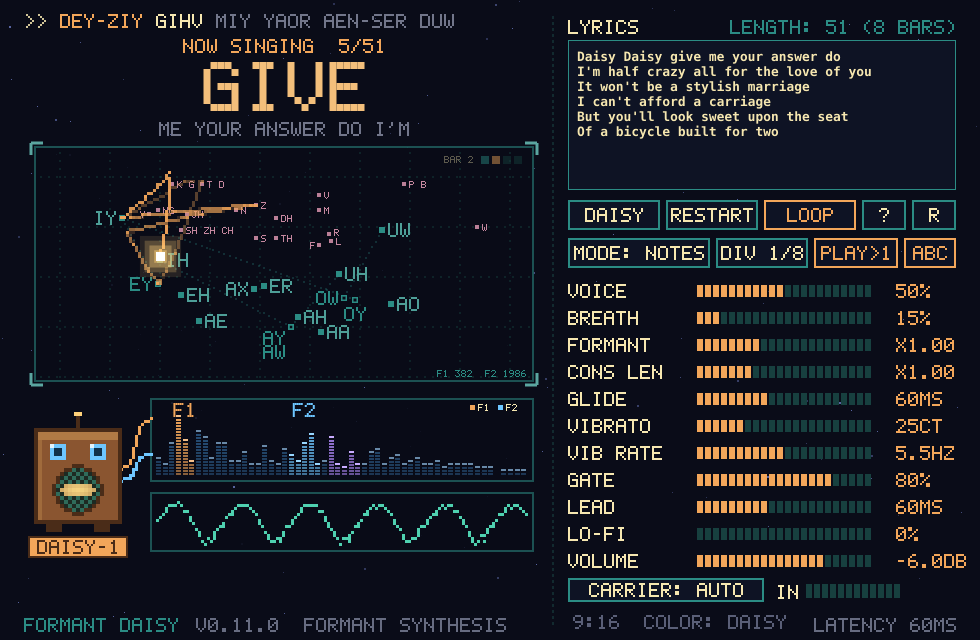
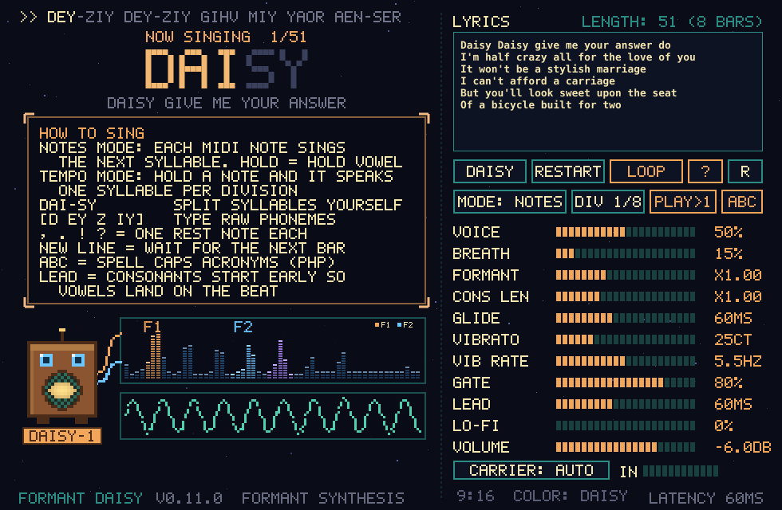
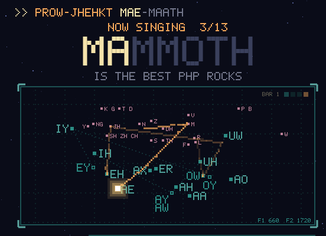
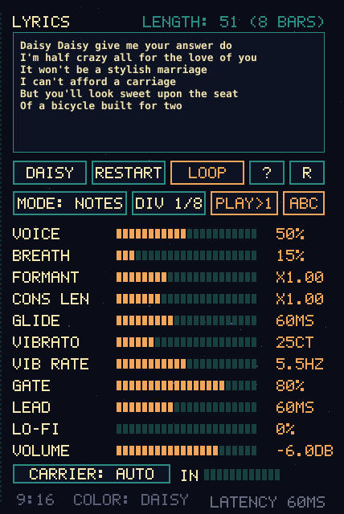
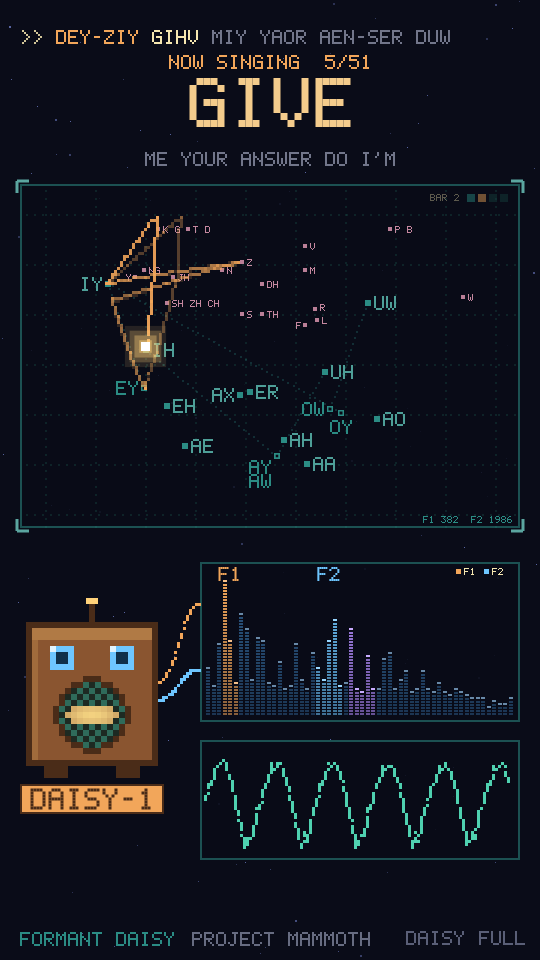
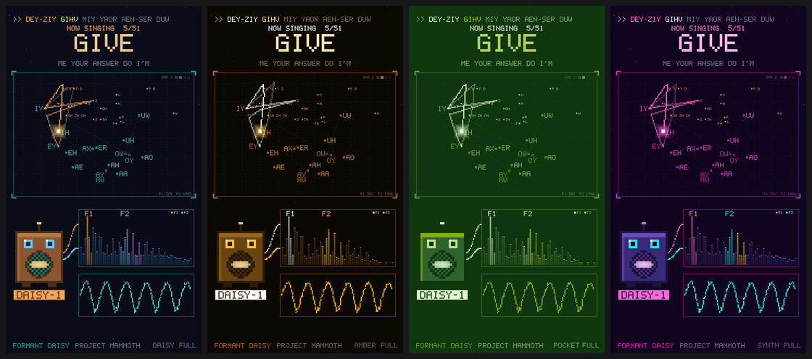
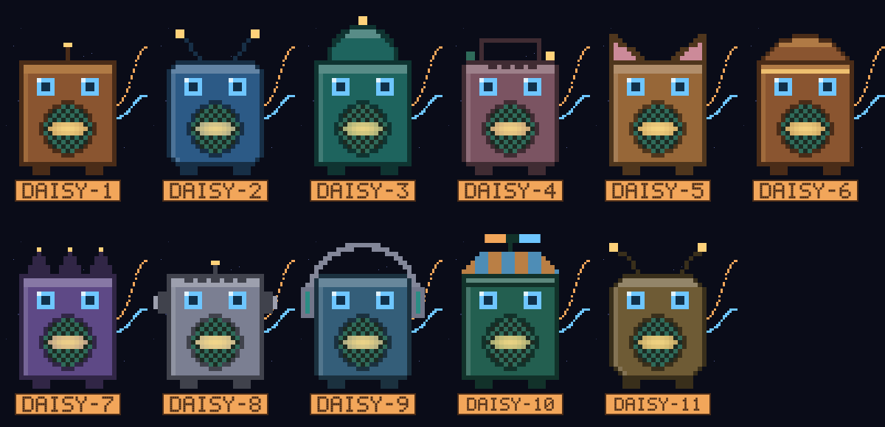

# Formant Daisy

A singing robot instrument plugin (VST3 / Standalone). Type lyrics, play MIDI, and it sings them one syllable per note using formant synthesis, the technique behind the 1961 Bell Labs IBM 7090 "Daisy Bell" demo and DECtalk.



**Version:** 0.11.0. See [CHANGELOG.md](CHANGELOG.md).

## Contents

- [Install](#install)
- [Quick start](#quick-start)
- [The display](#the-display)
- [Writing lyrics](#writing-lyrics)
- [Notes mode and Tempo mode](#notes-mode-and-tempo-mode)
- [Controls](#controls)
- [Audio input (vocoder style)](#audio-input-vocoder-style)
- [Compact 9:16 view, colors and robots](#compact-916-view-colors-and-robots)
- [How the sound is made](#how-the-sound-is-made)
- [Building from source](#building-from-source)
- [Releases](#releases)

## Install

Download the zip for your system from the [Releases](../../releases) page.

| System | Copy `Formant Daisy.vst3` to |
|---|---|
| Windows | `C:\Program Files\Common Files\VST3\` |
| Linux | `~/.vst3/` |

Rescan plugins in your DAW. Formant Daisy shows up as an instrument from **Project Mammoth**. The Standalone zip has a version you can run without a DAW.

## Quick start

1. Put Formant Daisy on a MIDI track. The Daisy Bell chorus is already loaded as lyrics.
2. Play notes. Each note sings the next syllable at that pitch, and holding the note holds the vowel.
3. For the full song, generate a MIDI file with `python3 tools/make_daisy_midi.py 150` and drop `DaisyBell_chorus.mid` on the track.
4. For the 1961 sound, set **VOICE** fully left (BUZZ) and **LO-FI** to about 60%.

## The display

| Area | What it shows |
|---|---|
| Top line (`>> DEY-ZIY ...`) | The phonemes of the current lyric line. Sung syllables are orange, the current one is cream, and upcoming ones are dim. |
| Big word | The word being sung, lit up syllable by syllable, with the next few words underneath and a `NOW SINGING x/y` counter. |
| Formant chart | Every phoneme placed by its first two formants (F1 down, F2 left). Vowels are teal, gliding vowels have a hollow marker, and consonants are pink. The glowing dot and orange trail show the voice moving between them. |
| BAR and beat boxes | Top-right of the chart. The current bar and beat from your DAW, with `WAIT` while a new line waits for the next bar. |
| Spectrum | The live frequency spectrum, with the F1 (orange) and F2 (blue) peaks labeled. |
| Scope | The output waveform. |
| Robot | The mouth follows the formants (F2 sets width, F1 sets height), the antenna lights while voiced, and the eyes blink on each rest. Click it to change the robot. |

The **?** button shows a quick reference in place of the chart:



## Writing lyrics

Type in the LYRICS box. Changes apply about a quarter second after you stop typing. The label above the box shows `LENGTH: n (m BARS)`, the notes needed for one pass and the bars that takes at the DIV note value in your project's time signature.

| You type | What happens |
|---|---|
| `daisy daisy` | Normal words, pronounced by a built-in dictionary plus English letter-to-sound rules. |
| `Dai-sy` | Hyphens force where the syllables split. |
| `[d ey \| z iy]` | Raw phonemes. `\|` splits syllables. DECtalk-style `[dey ziy]` also works. |
| `PHP`, `NASA` | All-caps words of 2 to 5 letters are spelled letter by letter ("pee aitch pee"). Toggle with **ABC**. Single letters like `I` and `A` stay words. |
| `,` `;` `:` `.` `!` `?` | Each mark is one rest. In Notes mode it uses up one note in silence, so `....` rests for four notes. |
| New line | Singing pauses until the next bar starts, then the next line begins on its downbeat. If a line already ends on the last beat, nothing is skipped. |
| Numbers | Read digit by digit. |

Phonemes: `iy ih eh ae aa ao ah uh uw er ax ey ay oy aw ow p b t d k g f v th dh s z sh zh ch jh hh m n ng l r w y`



## Notes mode and Tempo mode

**Notes mode** (default): every MIDI note sings the next syllable at that note's pitch. Overlapping notes glide (GLIDE). Because the notes drive the syllables, the singing follows your DAW's tempo automatically.

**Tempo mode**: hold any note and it speaks one syllable per **DIV** step (1/4, 1/8, 1/8T, 1/16), locked to the host's bar and beat, at the held pitch. **GATE** sets how much of each step is voiced.

In both modes the plugin follows the host's bar, beat and time signature while it plays. When stopped, it keeps counting at the project tempo and the beat display dims.

**Restarting the lyrics:** the RESTART button, the automatable "Restart Lyrics" parameter, or automatically when the transport starts (**PLAY>1**).

## Controls



| Control | What it does |
|---|---|
| DAISY | Loads the Daisy Bell chorus as lyrics. |
| RESTART | Jumps back to the first syllable. |
| LOOP | Starts the lyrics over when they run out. |
| ? | Shows the help panel. |
| R | Resets every parameter to its default. Lyrics are kept. |
| MODE | Notes or Tempo mode. |
| DIV | Tempo mode step length. Also used for the bar count in LENGTH. |
| PLAY>1 | Restarts the lyrics when the DAW starts playing. |
| ABC | Spells out all-caps acronyms. |
| VOICE | The voice source, from a bright buzz (sawtooth) to a softer glottal pulse. |
| BREATH | Adds breathy noise to voiced sounds. |
| FORMANT | Scales every formant. Below 1 is a larger voice, above 1 a smaller one. |
| CONS LEN | Makes consonants shorter or longer. |
| GLIDE | Pitch slide between overlapping notes. |
| VIBRATO / VIB RATE | Vibrato depth (cents) and speed. It fades in after each note starts. |
| GATE | Tempo mode: how much of each step is voiced. |
| LEAD | Starts consonants early so vowels land exactly on the beat. The plugin reports this as latency so your DAW compensates. Set it to 0 for live playing. |
| LO-FI | Sample-rate and bit reduction. |
| VOLUME | Output level. |
| CARRIER | What the formants shape: AUTO, BUZZ or INPUT. See below. |
| 9:16 / FULL | Switches between the full and compact views. |
| COLOR | Cycles the color schemes. |

All settings, the lyrics, the view, color scheme and robot are saved with your project.

## Audio input (vocoder style)

Route audio into the plugin and the lyrics' vowels and consonants are shaped onto it, like a talk box. MIDI notes still trigger each syllable, the pitch comes from the incoming audio (a chord pad sings in chords), and consonant noise stays internal so words remain readable.

**In Ableton:** on the source track, set "Audio To" to the Formant Daisy track and choose the plugin in the second menu. You can also use the Sidechain section in the plugin's device header.

**CARRIER** sets the source:

- **AUTO** (default): uses the input whenever audio has arrived in the last 1.5 seconds, otherwise the internal buzz. The button turns orange while the input is in use.
- **BUZZ:** always the internal buzz.
- **INPUT:** always the input.

The input is leveled automatically, and the **IN** meter shows its level. Bright, harmonically rich sources (saw pads, distorted guitar, noise) work best. A pure sine has no harmonics for the formants to shape.

## Compact 9:16 view, colors and robots

Click **9:16** for a compact view with just the display and the robot. It's 540×960, exactly half of a 1080×1920 YouTube Shorts frame, so a 2× scale gives clean pixels. **FULL** switches back. Both buttons stay dim until you hover over them, so they barely show in recordings.



**COLOR** cycles four color schemes: Daisy, Amber Terminal, Pocket Green and Synthwave.



**Click the robot** to switch between 11 robots. They all share the same speaker-grille mouth and eyes.



## How the sound is made

A voice is a buzzy source (the vocal cords) going through a filter (the throat and mouth). The filter's resonant peaks are the **formants**, and the pattern of peaks is what makes each vowel.

- **F1** (about 250 to 900 Hz) follows how open the jaw is. EE and OO are low, AH is high.
- **F2** (about 600 to 2500 Hz) follows the tongue position and lip rounding. EE is high, OO is low.
- Consonants are noise through bandpass filters (S, SH, F), or a short silence then a burst of noise (P, T, K).

The engine is a Klatt-style formant synthesizer:

- **Source:** a band-limited buzz blended with a KLGLOTT88 glottal pulse, plus aspiration noise.
- **Vowels:** five cascaded resonators (F1 to F5), with a nasal pole/zero pair for M, N and NG.
- **Consonants:** frication noise through parallel resonators.
- **Transitions:** formant targets glide with per-phoneme timing, which is what makes consonants come across.

Text goes through a pronunciation dictionary, then NRL-style letter-to-sound rules (Elovitz et al., 1976), then a syllabifier.

The formant values for every phoneme are in `Source/engine/Phonemes.cpp`, which is handy if you want to recreate the sound with bandpass filters on a modular synth.

## Building from source

Requires CMake 3.22+ and a C++17 compiler (Visual Studio 2022 on Windows, GCC or Clang on Linux). JUCE 8 is downloaded automatically.

```
cmake -B build -DCMAKE_BUILD_TYPE=Release
cmake --build build --config Release --target FormantDaisy_VST3 FormantDaisy_Standalone
```

Output goes to `build/FormantDaisy_artefacts/Release/`.

Linux needs these packages: `libasound2-dev libx11-dev libxrandr-dev libxinerama-dev libxcursor-dev libxext-dev libfreetype-dev libfontconfig1-dev libgl1-mesa-dev`

Options:

- `-DJUCE_DIR=/path/to/JUCE`: use an existing JUCE checkout instead of downloading one.
- `-DFD_VST3_MANIFEST=OFF`: skip generating `moduleinfo.json` (needed when cross-compiling).
- `-DFD_BUILD_DEV_TOOLS=ON`: also build `ui_snapshot`, which drives the plugin without a host and saves editor screenshots. It made the images in this README.

The `render_daisy` tool (built by default, no JUCE needed) renders the chorus to a WAV without a DAW:

```
render_daisy out.wav [bpm] [voice 0..1] ["lyrics"]
```

### Source layout

```
Source/engine/       plain C++17 sound engine, no JUCE
  Phonemes.*         phoneme table (formants, bandwidths, noise shapes)
  TextToPhonemes.*   dictionary, letter-to-sound rules, syllables, rests, line breaks
  FormantSinger.*    synthesis and note/tempo sequencing
Source/Plugin*.*     JUCE processor and pixel-art editor
Source/PixelFont.*   hand-drawn 5x7 bitmap font
tools/               test renderers, MIDI generator, screenshot tool
docs/images/         README screenshots
```

## Releases

Versions follow `MAJOR.MINOR.PATCH`, and the minor number goes up with every change. The version lives in one place, `project(FormantDaisy VERSION ...)` in `CMakeLists.txt`, and is shown in the plugin's footer.

To publish a release:

1. Bump the version in `CMakeLists.txt` and add an entry to `CHANGELOG.md`.
2. Commit, then tag and push:

   ```
   git tag v0.12.0
   git push origin main v0.12.0
   ```

The **Release** workflow (`.github/workflows/release.yml`) then builds Windows and Linux and attaches these files to a GitHub Release:

- `FormantDaisy-<version>-Windows-x64-VST3.zip`
- `FormantDaisy-<version>-Windows-x64-Standalone.zip`
- `FormantDaisy-<version>-Linux-x64-VST3.zip`
- `FormantDaisy-<version>-Linux-x64-Standalone.zip`

The workflow fails if the tag doesn't match the version in `CMakeLists.txt`. You can also run it by hand from the Actions tab to get test builds without making a release.

## Credits

- Visual style inspired by Bit Wonder's short "Formant Synthesis Makes Buzzes Sing".
- D. H. Klatt, "Software for a cascade/parallel formant synthesizer", JASA 1980.
- Elovitz, Johnson, McHugh and Shore, "Automatic translation of English text to phonetics by means of letter-to-sound rules", NRL Report 7948, 1976.
- "Daisy Bell" by Harry Dacre (1892) is in the public domain.
- Built with [JUCE](https://juce.com).
